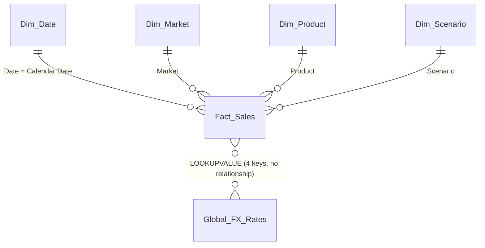

# FX Variance Cockpit

**A Power BI report that restates a global pharma company's sales into any currency, using the right exchange rate for every scenario, and shows how actuals really compare with budget.**

<p align="center">
  
</p>

> Started as a Power BI assessment. I then rebuilt and extended it: fixed a currency gap, a misleading variance and an inconsistent number format. The story of those fixes is [below](#bugs-i-found-in-my-own-first-version).

---

## Why this is harder than it looks

Net sales arrive in EUR, CHF, TRY, RUB and USD across five scenarios: Actuals, Budget and three forecasts. Finance wants **one number, in one currency, that they can trust.**

| The catch | How the report handles it |
|---|---|
| Every scenario needs a **different type of FX rate**: Actuals use the monthly rate, Budget the fixed budget rate, forecasts the hyper-inflation rate | A scenario-to-rate-type mapping table, then a rate lookup for every sales row in DAX |
| The fiscal year runs **July to June** | Fiscal calendar generated in Power Query. The key `FY × 1000 + fiscal month` (e.g. `2026001` = Jul 2025) matches the FX table exactly |
| Some currency pairs have **no direct rate** (e.g. EUR → GBP) | Falls back to converting through USD, which is how the rate table itself is built |
| **Actuals stop in December**, but the budget runs to June | Variance compares Budget only over the months that have Actuals, never 6 months against 12 |
| Executives read it at a glance | Currency symbol, K / M / absolute units and decimals all follow slicers. Empty states say *why* they are empty |

## What's in the report

- **Control band:** reporting currency (USD, EUR, GBP, CHF), display unit (Absolute, Thousands, Millions) and decimals. Every visual follows them.
- **Four KPI cards:** Actual, Budget (same months), Variance and Variance %, coloured green or red by sign.
- **Variance by product:** which medicines are driving the gap.
- **Monthly trend:** one line per scenario over the fiscal year.
- **Scenario comparison table:** pick up to three scenarios and compare them side by side by month.
- **Filters:** fiscal month, market and scenario.

## Under the hood

### Model



`Dim_Scenario` carries the rate type for each scenario. `Dim_Currency`, `Format Slicer` and `Decimals` are disconnected tables that only feed slicers. The FX table is looked up with `LOOKUPVALUE` because the match needs four keys at once: from-currency, to-currency, fiscal period and rate type.

### The conversion, in one measure

```dax
Rate = COALESCE(DirectRate, LegToUSD * LegFromUSD)
RETURN 'Fact_Sales'[Net Sales Local] * Rate
```

For each sales row: use the direct rate if one exists, otherwise multiply the two legs through USD. A missing rate returns `BLANK()`, never a made-up zero. Full measure: [`model/measures.dax`](model/measures.dax).

### Like-for-like variance

```dax
Budget Sales Card =
VAR ActualDates =
    CALCULATETABLE(VALUES('Fact_Sales'[Calendar Date]),
        'Fact_Sales'[Scenario] = "Actuals", ALL('Dim_Scenario'[Scenario]))
RETURN
    CALCULATE([Value Adjusted],
        'Dim_Scenario'[Scenario] = "Budget", ALL('Dim_Scenario'[Scenario]),
        TREATAS(ActualDates, 'Dim_Date'[Date]))
```

Find the dates that have Actuals, then total Budget for those dates only.

### One format string for everything

A single `Currency Format String` measure builds the symbol, decimals and K/M suffix, and is used as the dynamic format string of every money measure. Change the Unit or Decimals slicer and the cards, the matrix and the chart labels stay in agreement.

## Bugs I found in my own first version

1. **GBP showed an empty report.** The slicer offered GBP, but the rate table only holds GBP rates *from USD*, so every EUR and CHF row had no rate. The measure now triangulates through USD. I checked first that the table's own EUR → CHF rates equal EUR → USD × USD → CHF in all 36 cases, so this follows the data's own method.
2. **A variance of -39%.** Five months of Actuals were being compared with eight months of Budget. The real, like-for-like variance was -3.2%.
3. **Three formats that disagreed.** The cards and the matrix each had their own copy-pasted format formula (1 decimal vs 2, with and without units). They now share one.
4. **A misleading dimension.** `Dim_Market` kept one arbitrary currency per market, which is wrong for markets that trade in several. Removed.
5. **A wrong currency symbol.** CHF was shown with the old French franc sign. Fixed.

## Repository guide

```
model/
  measures.dax            every DAX measure, commented
  tables.dax              the Decimals selector table
  power-query/            one .m file per query (fact, FX rates, dimensions, fiscal calendar)
theme/
  FX_Variance_Cockpit_Theme.json   custom Power BI theme
docs/
  design-decisions.md     why each choice was made, plus interview-style Q&A
images/                   screenshots
```

## Rebuild it

1. In Power BI Desktop, create each query from `model/power-query/` (Home → Transform data → New Source → Blank Query → Advanced Editor). Set `DataFolder` in the two CSV queries.
2. Create the relationships shown in the model diagram. Mark `Dim_Date` as a date table and sort `Month Display` by `FiscalPeriodKey`.
3. Add `Decimals` from `model/tables.dax`, then the measures from `model/measures.dax`. Set the dynamic format string of the money measures to `[Currency Format String]`.
4. Import the theme (Design → Themes → Browse for themes).

## Data note

The sales and FX data come from an assessment dataset and are not included in this repository. The expected columns are:

- **Sales:** Scenario, Market, FromCurrency, Net Sales Local, Calendar Date, Product
- **FX rates:** Overall FX Rate, From Currency, To Currency, Fiscal Year/Period, Rate Type

## How it was built

Power BI Desktop, DAX and Power Query (M). I rebuilt and extended the original with AI assistance (Claude) as a pair-programming partner, and every design choice is written up in [`docs/design-decisions.md`](docs/design-decisions.md) so that I can explain and defend it.
